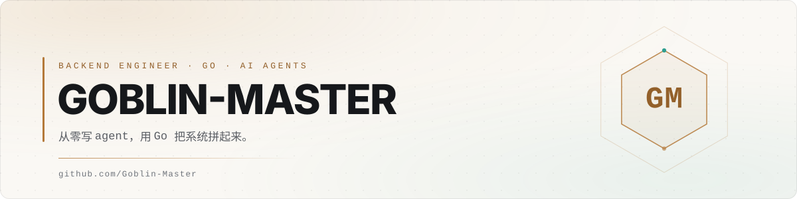

<picture>
  <source media="(prefers-color-scheme: dark)" srcset="./assets/banner-dark.svg">
  <source media="(prefers-color-scheme: light)" srcset="./assets/banner-light.svg">
  
</picture>

<div align="center">

[](https://github.com/Goblin-Master?tab=followers)
[](https://github.com/Goblin-Master/goblin)
[](https://goblin-master.github.io/Goblin-Master/)

</div>

## 关于

后端工程师。喜欢把系统拆开看结构——DDD、IOC、分层边界，这些比换框架本身更让我上心。
最近在啃 agent：不套现成框架，从主循环、工具注册、上下文压缩一层层自己实现。

```go
type Engineer struct {
    Focus   []string // 后端 · 微服务 · Agent
    Stack   []string // Go, Gin, go-zero, GORM, Vue 3
    Current string   // 从零写一个 CLI agent
}
```

## 正在做

### [goblin](https://github.com/Goblin-Master/goblin) · 从零实现的 CLI Agent

不依赖 LangGraph、OpenHands、OpenClaw 这类框架，主循环、工具注册、上下文压缩、Session 持久化全部在本仓库实现；模型接 DeepSeek 的 OpenAI 兼容接口。

- **Agent 主循环** — 工具执行、结果回填、错误回喂、最大轮次保护
- **原生 `tool_calls`** — 工具描述与 JSON Schema 随请求下发，由模型自主决策
- **上下文压缩** — 按 token 预算自动触发，`/compact` 手动压到消息末尾，摘要失败自动降级
- **Session** — UUID 严格恢复，MySQL 持久化，窗口之间互不污染
- **结构化日志** — JSONL 记录每次 LLM 请求与工具调用，每条带 `session_id` / `trace_id`

`Go` `Cobra` `DeepSeek` `MySQL` `Viper`

## 其他项目

| 项目 | 说明 | 栈 |
|:---|:---|:---|
| **[volunteer-team](https://github.com/Goblin-Master/volunteer-team)** ⭐ 10 | 志愿团队管理系统，认证、权限、报表一条龙 | `Vue 3` `Gin` `GORM` `Redis` `RabbitMQ` |
| **[island](https://github.com/Goblin-Master/island)** ⭐ 4 | 按 DDD + IOC 搭的 Go Web 框架，带 AI 与实时聊天 | `Go` `Gin` `WebSocket` `GORM` |
| **[framework](https://github.com/Goblin-Master/framework)** ⭐ 2 | 面向接口 + DDD + IOC 的架构骨架 | `Go` |
| **[Debate-System](https://github.com/Goblin-Master/Debate-System)** | 基于 go-zero 的辩论系统，WebSocket 通讯 + AI 自动辩论 | `go-zero` `WebSocket` |
| **[statusly](https://github.com/Goblin-Master/statusly)** | 极简 HTTP 状态码速查浏览器扩展（Manifest V3） | `JavaScript` |
| **[Claw](https://github.com/Goblin-Master/Claw)** | 用 Cobra 一点点写出来的 CLI 实验场 | `Go` `Cobra` |

## 技术栈


<sub>Gin · go-zero · GORM · Cobra · WebSocket · RabbitMQ · Element Plus</sub>

## 数据

<div align="center">


</div>

## 联系

[](https://github.com/Goblin-Master)
&nbsp;
[](https://github.com/Goblin-Master/Goblin-Master/issues/new)

---

<div align="center"><sub>写代码是把手弄脏的活。</sub></div>
