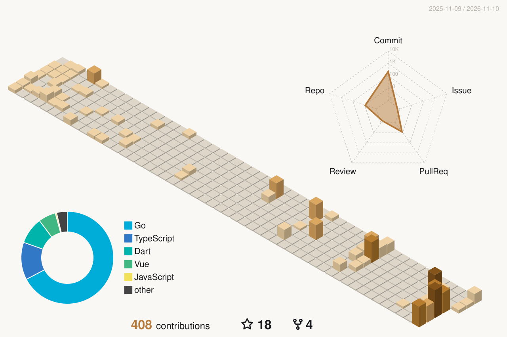

  
  
  
  
  

### Hi there, I'm Goblin-Master 👋

### 🛠 About Me

用 Go 写后端，顺手也写点前端。喜欢把系统拆开看结构，最近在从零实现一个 CLI Agent。

  <picture>
    <source media="(prefers-color-scheme: dark)" srcset="profile-3d-contrib/profile-copper-dark.svg" />
    <source media="(prefers-color-scheme: light)" srcset="profile-3d-contrib/profile-copper-light.svg" />
    
  </picture>

### 🤝 Connect with Me

  

